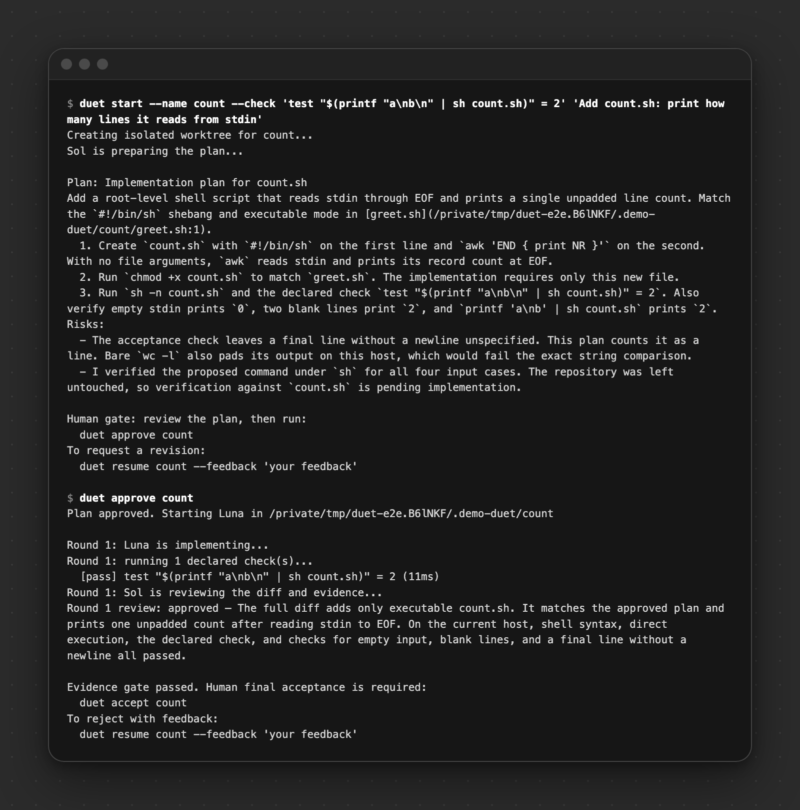
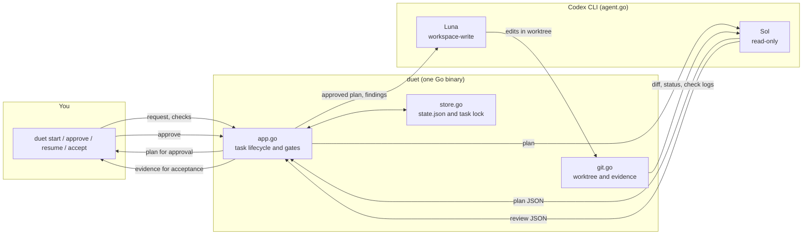

# duet

<p align="center"><a href="https://preacherxp.github.io/30-days-of-tools/"></a></p>

<p align="center"><a href="https://buymeacoffee.com/michal.hachula"></a></p>

A command line tool for people who run AI coding agents that puts two Codex CLI sessions on one task: Sol plans and reviews, Luna implements in an isolated Git worktree, and you approve the plan and accept the result.

You run `duet start` with a request and at least one `--check` command that must pass. duet creates a `duet/<task>` branch in a separate worktree, asks a read-only Sol session for a plan, prints it and stops. When you run `duet approve`, Luna implements the plan in the worktree, duet runs your checks, and Sol reviews the full diff with the check results. Blocking findings or failed checks go back to the same Luna session for another round, up to three rejected reviews, and then duet stops again and waits for you. Nothing is committed or merged, and the branch you are on is never touched: accepted work waits in its worktree with a handoff note telling you how to integrate it.

<p align="center"></p>

## Requirements

- macOS or Linux. Windows is not supported.
- Git with worktree support
- The [Codex CLI](https://learn.chatgpt.com/docs/codex/cli), installed and signed in with a paid account. Run `codex` once and complete sign-in before using duet. Tested with `codex-cli 0.169.0`.
- Go 1.23 or later to build it

## Install

```sh
go install github.com/preacherxp/duet/cmd/duet@latest
```

Or from source, into `~/.local/bin`:

```sh
git clone https://github.com/preacherxp/duet.git
cd duet
make install                     # builds ~/.local/bin/duet; set PREFIX=... to install to $PREFIX/bin
```

Make sure the install directory is on `PATH` (for `make install`, add `export PATH="$HOME/.local/bin:$PATH"` to `~/.zshrc` or `~/.bashrc`), then check it with `duet version`. To update, run the same install command again. To uninstall, run `make uninstall`, or delete the binary: `rm ~/.local/bin/duet`.

## Usage

Run duet inside the repository you want to change, or pass `--repo PATH` to any command.

```sh
duet start --name retry-client \
  --check 'go test ./...' --check 'go vet ./...' \
  'Add bounded retries to the HTTP client'        # create the worktree, Sol plans, then stop
duet resume retry-client --feedback 'Keep the public API'   # ask Sol for a revised plan
duet approve retry-client                         # run the Luna and Sol loop
duet approve retry-client --feedback 'Notes for Luna'       # same, with notes for Luna
duet status retry-client                          # state, worktree, diff and check logs, findings
duet resume retry-client --feedback 'Also cover cancellation'  # reject the result: another batch
duet accept retry-client                          # record acceptance, print the handoff
duet list                                         # every task in this repository
```

```text
start → Sol plans → you approve → Luna implements → checks → Sol reviews
                                           ↑               │
                                           └── fix round ───┘
                                                          ↓
                                      you accept → integration handoff
```

- **Two gates.** duet stops twice and waits for a command from you: after the plan (`approve`, or `resume --feedback` for a new plan) and after the evidence gate passes (`accept`, or `resume --feedback` to reject and send Luna back). There is no interactive prompt, so it works the same in scripts and over SSH.
- **The evidence gate.** A round passes only when every `--check` exits 0 and Sol returns `approved` with no blocking findings. Passing checks alone are not enough.
- **Pauses.** duet pauses after `--max-rejections` rejected reviews (3 by default), when a check command is not found (exit 127), when Codex fails, times out or is interrupted with Ctrl-C. `duet status` shows why, and `duet resume <task> --feedback '…'` authorises another batch with a fresh rejection allowance. If duet itself was killed mid-run, `status` says the task was interrupted and `resume` picks it up.
- **Accept.** `duet accept` refuses if the worktree changed after Sol's review. Otherwise it writes `HANDOFF.md` with the worktree, branch, base commit, evidence and suggested `git` commands. It does not commit, merge, rebase, push or open a pull request.
- **Uncommitted work.** The worktree starts from `--base` (default `HEAD`), so your uncommitted changes are not included. duet prints a note when tracked files have uncommitted changes, and never changes them.
- **One process per task.** A second `duet` on the same task is refused while the first is running. Different tasks can run side by side.

Options for `start`:

| Option | Default | Meaning |
| --- | --- | --- |
| `--name ID` | request slug plus timestamp | Task ID and `duet/ID` branch name |
| `--check COMMAND` | required | Acceptance check, run with `/bin/sh` in the worktree; repeat for more |
| `--base REF` | `HEAD` | Commit or ref the task branch starts from |
| `--check-timeout DURATION` | `10m` | Limit for each check |
| `--agent-timeout DURATION` | `2h` | Limit for each Codex run: one plan, one review or one Luna round |
| `--max-rejections N` | `3` | Rejected reviews allowed per batch |
| `--sol-model`, `--luna-model` | your Codex default | Model for each role |
| `--codex-bin PATH` | `codex` | Codex executable |
| `--worktree-root PATH` | `../.<repo>-duet` | Parent directory for task worktrees |
| `--repo PATH` | `.` | Target repository |

Task state and evidence stay out of your tracked files, in the repository's Git directory: `.git/duet/tasks/<task>/` holds `state.json`, every Codex event log (`*.jsonl`) and stderr log, each round's `round-NN.diff`, `round-NN.status` and check logs, and `HANDOFF.md`. Worktrees go to a sibling directory, `.<repo>-duet/<task>/`. Nothing is sent anywhere except through Codex itself.

duet never deletes anything. When you are done with a task, integrate it and clean up by hand:

```sh
git -C ../.myrepo-duet/retry-client add -A
git -C ../.myrepo-duet/retry-client commit -m 'Add bounded retries'
git merge --ff-only duet/retry-client             # or open a pull request from the branch
git worktree remove ../.myrepo-duet/retry-client
git branch -d duet/retry-client
rm -rf .git/duet/tasks/retry-client
```

## Limits

- It needs a paid Codex account, and a task runs two Codex sessions plus a review per round, so it uses about twice the allowance of doing the same task in one session.
- macOS and Linux only. Windows does not build.
- It does not merge, commit, push or open pull requests, and it has no cleanup command. Integration is always yours.
- Codex is the only supported agent.
- Luna works in Codex's `workspace-write` sandbox with approvals turned off: it can write inside the task worktree and Codex's default temporary directories, but not anywhere else. Network access is left to your Codex settings; with `codex-cli 0.169.0` and no network setting, Luna could reach the internet. Sol is read-only.
- Your `--check` commands run outside the sandbox with your permissions, and they run the code Luna wrote. Treat a check like running the tests of an untrusted pull request.
- Each batch stops after three rejected reviews by default, even when one more round might have fixed it.

## Architecture



- **`cmd/duet/main.go`** turns Ctrl-C and `SIGTERM` into a cancelled context, so a running Codex process is stopped and the task is saved as paused instead of being left half done.
- **`internal/duet/cli.go`** parses the commands and flags. Every command that changes a task takes the task lock first and only then reads `state.json`, so two processes can never act on the same state.
- **`internal/duet/app.go`** holds the state machine: planning, awaiting plan approval, running, awaiting acceptance, paused and accepted. It runs the checks with `/bin/sh -c` in the worktree, applies the evidence gate, counts rejections and writes the handoff.
- **`internal/duet/agent.go`** runs `codex exec --json` with the prompt on stdin, never through a shell, and keeps each role's thread ID so later rounds use `codex exec resume`. It passes `sandbox_mode` and `approval_policy="never"` on every call, because a resumed Codex session does not keep the sandbox it started with: without that, a resumed Luna was read-only and a resumed Sol would take whatever the user's config or project trust allows. Plans and reviews are forced into JSON with `--output-schema` and decoded strictly. Each run has a timeout and gets an interrupt, then a kill 10 seconds later.
- **`internal/duet/git.go`** finds the repository and its common Git directory, creates the worktree with `git worktree add -b duet/<task>` from a resolved commit, and records the diff (untracked files included) and status after each round. In your own checkout duet runs only `rev-parse`, `status`, `show-ref`, `worktree list` and that one `worktree add`, which adds a branch and a worktree but checks nothing out where you are.
- **`internal/duet/store.go`** writes `state.json` through a temporary file and a rename, so a crash never leaves it half written. The task lock is a file holding the owner's PID; a lock left by a dead process is replaced.

[DECISIONS.md](DECISIONS.md) records why the design has two human gates, one worktree per task, persistent sessions per role and a bounded loop.

## Development

```sh
make test     # go test, go test -race and go vet
make build    # ./duet in the repository root
```

The tests need Git and `/bin/sh`, not Codex: a shell script stands in for `codex` and records every argument duet passes. They cover the full workflow, plan revision, the correction loop and its cutoff, failed, missing and timed out checks, a failing, hanging or interrupted Codex, crash recovery, the task lock, stale evidence at acceptance, unusual file names, and that your branch, `HEAD` and working tree are unchanged with a dirty tree or a detached `HEAD`. The version lives in `internal/duet/cli.go`.

## License

[MIT](LICENSE)

<sub>If it saves you from babysitting two agents, you can [buy me a coffee](https://buymeacoffee.com/michal.hachula).</sub>
